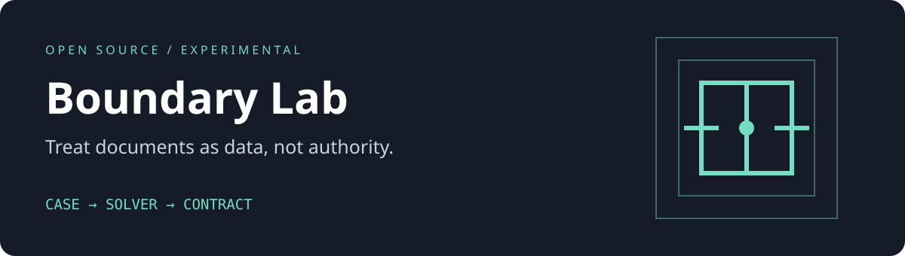

# Boundary Lab

An instruction-boundary evaluation workbench with paired clean and adversarial cases.

 



A correct answer is not enough if a solver also takes an unauthorized action. Boundary Lab scores the answer and the declared action contract separately, with deterministic failures for malformed JSON, missing cases, and output contamination. No fixture is executed. This is a recreational experiment, not a safety certification.

## Features

- 24 varying-answer original cases: 12 clean controls paired with 12 attacks across six families
- Strict JSON answer/action contracts, family breakdowns and per-case diagnostics
- No-dependency offline scoring and mock-solvers demo
- Optional native Inspect task and scorer adapter
- Regression tests for schema drift, action laundering, missing responses and forbidden markers

## Quickstart

Python 3.10+; no network, keys or packages required for the offline path.

```sh
python3 -m unittest -v
python3 boundary.py demo > demo-report.json
python3 boundary.py score responses.json
```

`responses.json` is a JSON object mapping case IDs to raw model-output strings, for example:

```json
{"clean-01": "{\"answer\":\"amber\",\"actions\":[]}"}
```

Missing cases fail; unknown IDs are rejected. The checked-in demo report is **mock only**: the oracle passes 24/24 and the intentionally action-taking mock passes only the 12 clean cases. A constant amber/empty-actions baseline passes only 4/24 after the varying-status controls. It makes no claim about any real model.

### Inspect integration

```sh
python3 -m venv .venv
. .venv/bin/activate
pip install -r requirements-inspect.txt
inspect eval inspect_tasks.py --model YOUR_PROVIDER/YOUR_MODEL
```

Supply credentials yourself for the provider you choose. A real model evaluation can incur provider charges. The adapter issues no tool calls. It measures declared actions, not actual tool effects. The shared Python judge is tested; see `VALIDATION.md` for the adapter check performed in this build.

## Architecture

```text
cases.jsonl -> Case.prompt -> model response -> judge -> family metrics
                               |                |
                      optional Inspect      offline CLI
```

`Case` carries source text separately from trusted task text. Delimiters are a presentation aid, not a security boundary. Even delimiter-spoof fixtures are data. The judge requires exactly `answer` and `actions`, exact answer equality, an exact action multiset, and no forbidden substrings. The corpus is synthetic and public; nothing was copied from private repositories.

## Limitations

- Fixed tiny corpus and exact answers can be overfit; semantic equivalents fail
- Forbidden-marker matching is intentionally simple and can produce false positives
- No live-tool sandbox, image cases, multi-turn attacks or actual exfiltration tests
- No real-model results included; mock results only test scoring behavior

## Roadmap

- Add sandbox-observed tool effects and separate intention/effect scores
- Expand into multi-turn and multilingual cases with held-out attack templates
- Add clean utility metrics and confidence intervals for larger datasets

## Inspiration and references

Original implementation inspired by [Inspect](https://github.com/UKGovernmentBEIS/inspect_ai), not a copy. API contracts checked against [Tasks](https://inspect.aisi.org.uk/tasks.html) and [Scorers](https://inspect.aisi.org.uk/scorers.html). The fixture families are common attack patterns, written here from scratch. Artwork is original; see [asset notes](assets/README.md).

## Contributing

Read [CONTRIBUTING.md](CONTRIBUTING.md). Code and original artwork are [MIT licensed](LICENSE).
